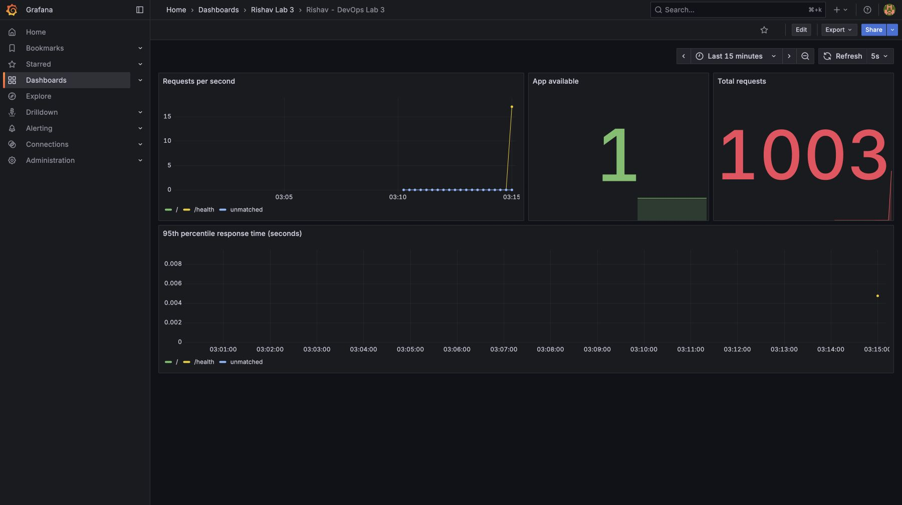

# devops-lab-3

Rishav | Roll no. 2301730245

DevOps and Automation — Lab 3: Automation, monitoring and DevSecOps.

The app adds Prometheus metrics, JSON request logs and a beta feature flag.
Ansible configures a demo node, Terraform creates Docker containers, and Jenkins
runs dependency, code and image scans.

**Monitoring**

```bash
docker compose -f monitoring/docker-compose.yml up -d --build --wait
curl http://localhost:5003/
curl http://localhost:5003/metrics
```

App: `http://localhost:5003`

Prometheus: `http://localhost:9090`

Grafana: `http://localhost:3300` (`admin` / `lab3-local-only`)

Grafana loads the datasource and dashboard from the files in `monitoring/`.
Set `GRAFANA_PASSWORD` before starting Compose to use a different local password.

**Logging**

Start monitoring first so the app log volume exists, then run:

```bash
docker compose -f logging/docker-compose.yml up -d
curl http://localhost:5003/health
```

Kibana is on `http://localhost:5601`. Create a data view for `rishav-lab3-*`
using `@timestamp` as the time field. This local exercise uses Elasticsearch
without authentication and binds its ports to localhost.

**Tests**

```bash
python3 -m venv .venv
source .venv/bin/activate
pip install -r requirements-dev.txt
python -m pytest tests/test_app.py -v
```

Ansible, Terraform, feature flags, browser testing and security pipeline commands
are in [docs/lab-record.md](docs/lab-record.md). The Jenkins script is
`security/Jenkinsfile`. GitHub Actions runs unit tests, security checks and an image build.

**Reports and screenshots**

[Submission map](docs/submission-checklist.md)

[Question-wise PDF reports](reports/README.md) | [Run screenshots](docs/screenshots/README.md) | [Command output](docs/commands/)


