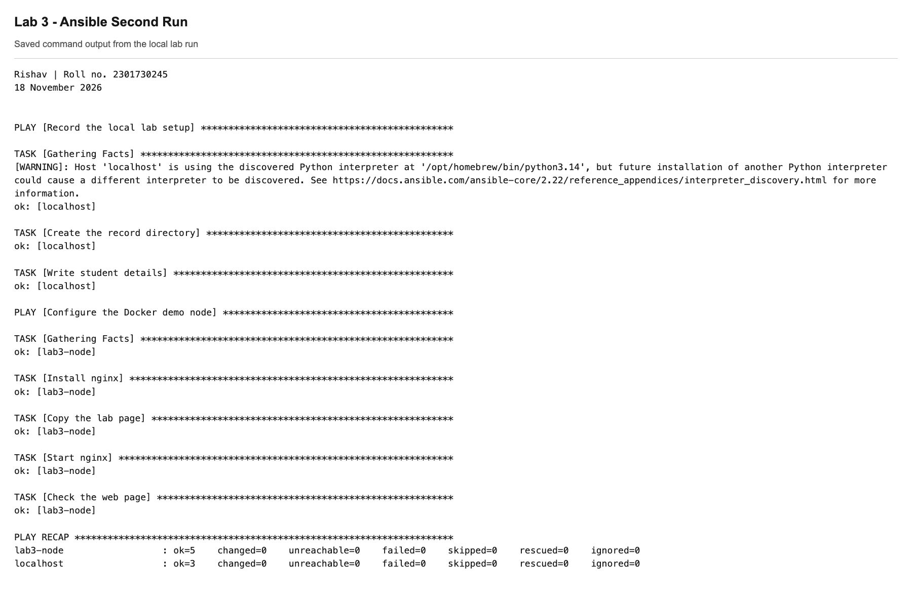
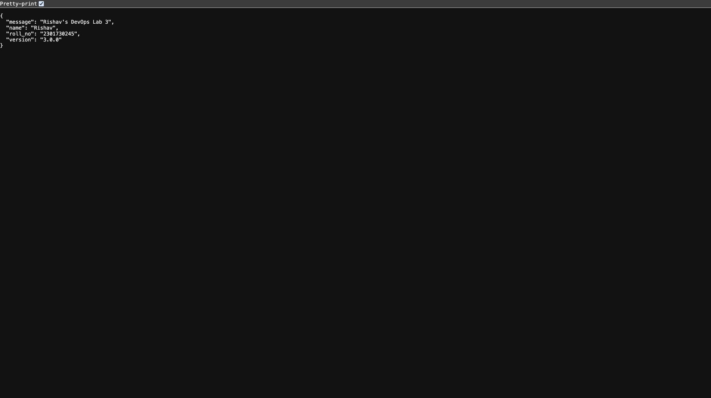
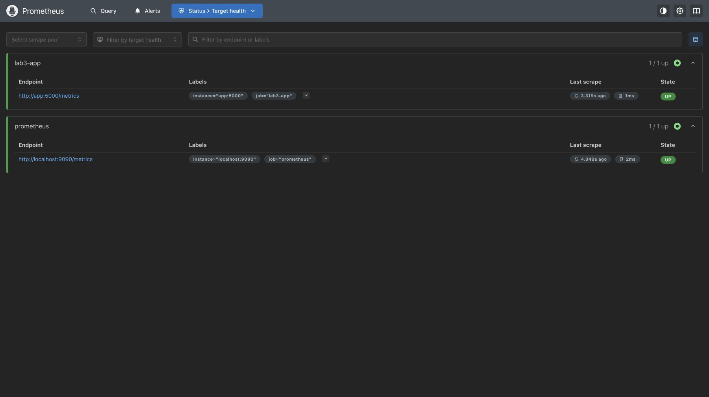
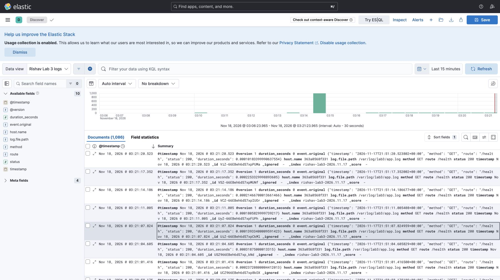
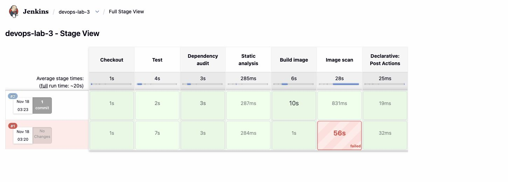
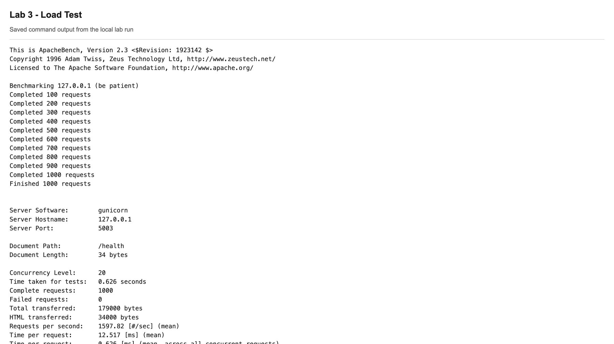

# Lab 3 screenshots

Rishav | Roll no. 2301730245

Captured from the actual local runs. Saved-command-output pages show the stdout kept in [command records](../commands/).

**beta browser**

**q1 ansible idempotency**

**q2 terraform containers**

**q3 app response**

**q3 grafana dashboard**

**q3 prometheus targets**

**q4 kibana discover**

**q5 jenkins security stages**

**q6 load test**

