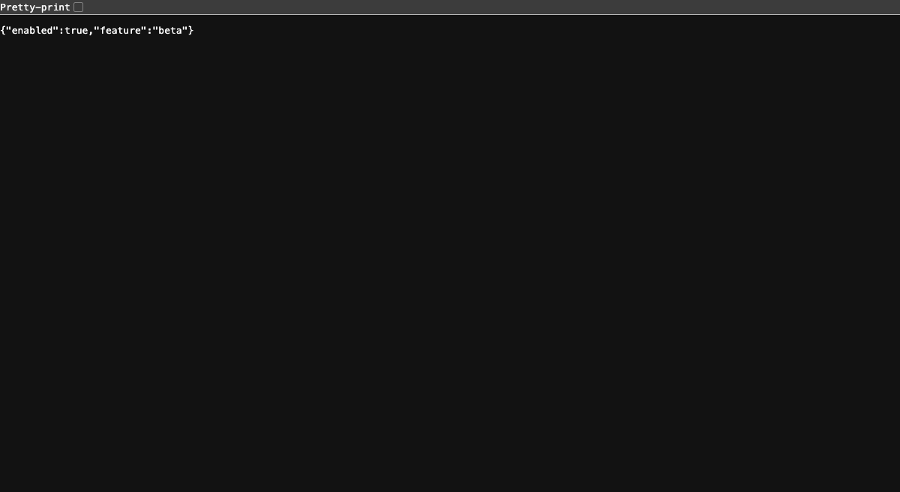
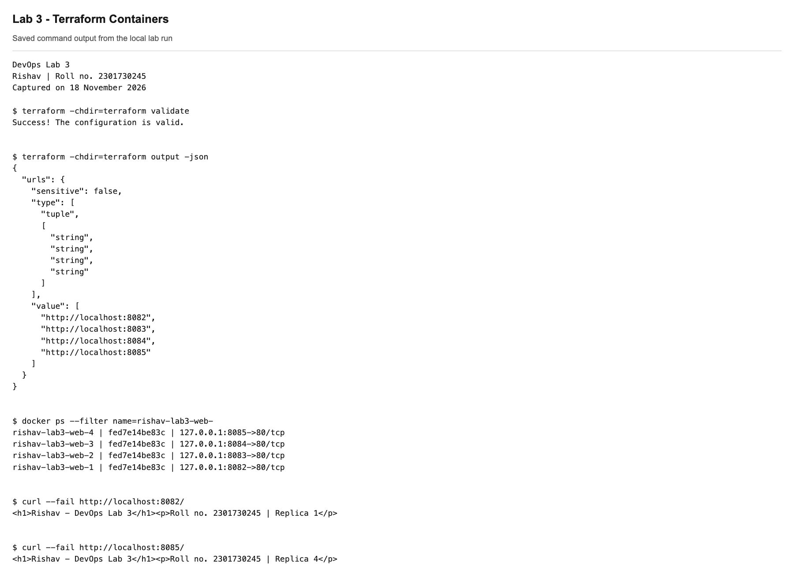
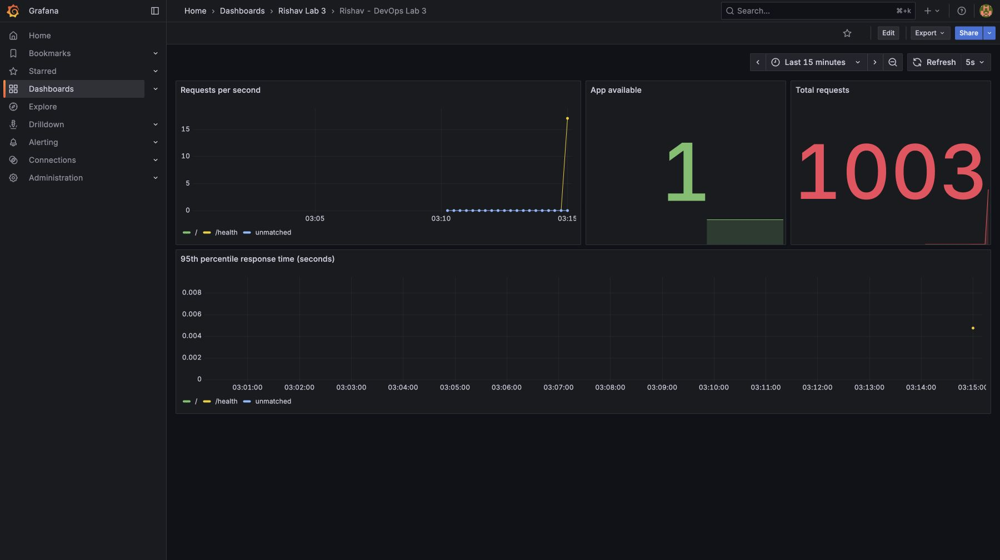

# Lab 3 screenshots

Rishav | Roll no. 2301730245

Captured from the local lab runs. The browser pages show the running tools and apps. Screenshots headed "Saved command output" show the stdout saved in [docs/commands](../commands/) from those runs.

**Beta browser**

**Ansible idempotency**

**Terraform containers**

**App response**

**Grafana dashboard**

**Prometheus targets**

**Kibana discover**

**Jenkins security stages**

**Load test**

